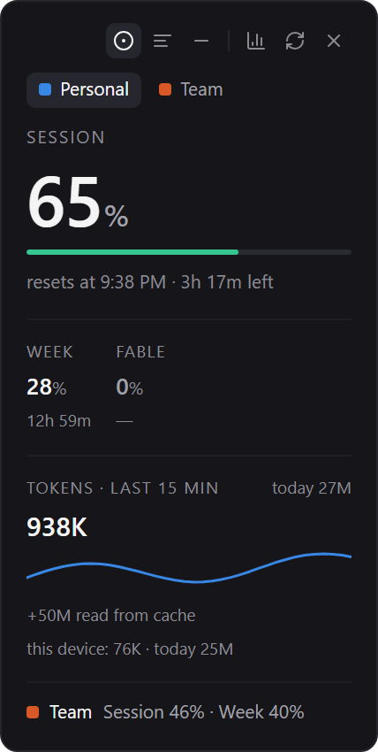
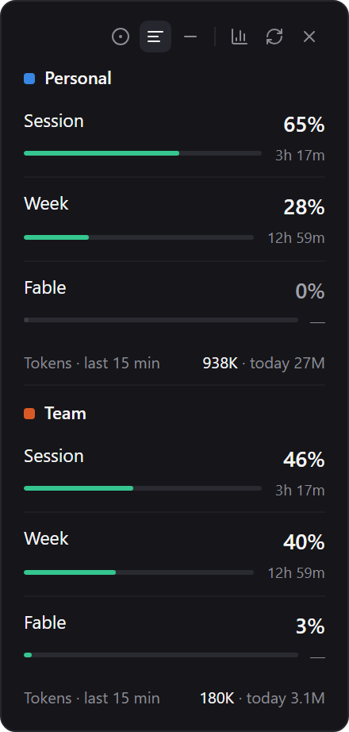
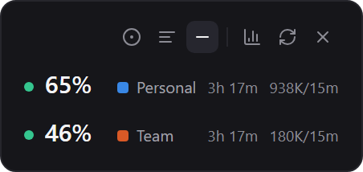
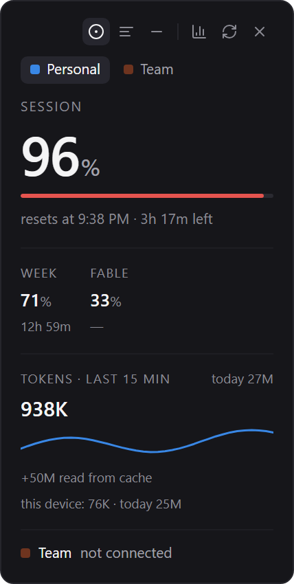
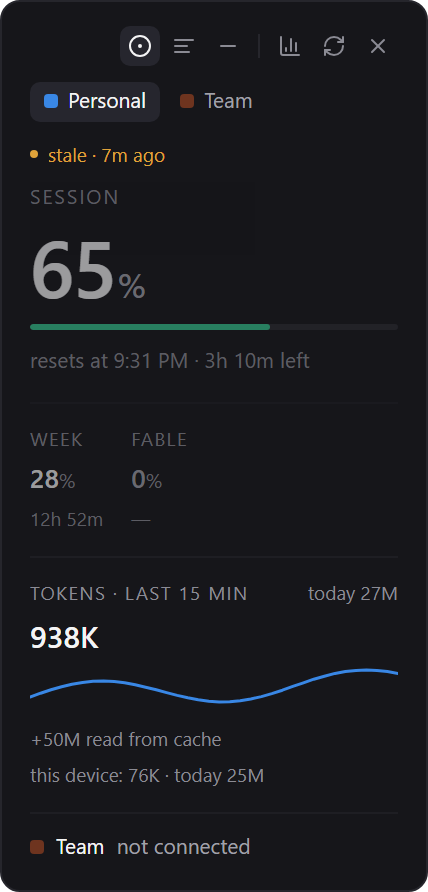
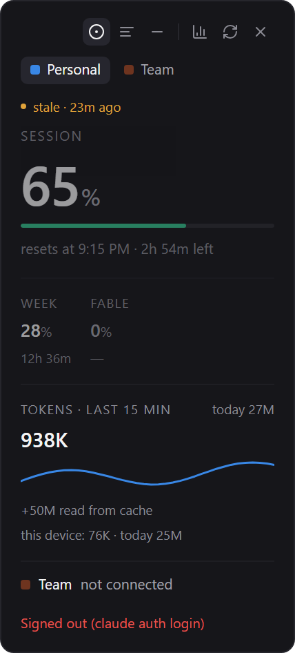
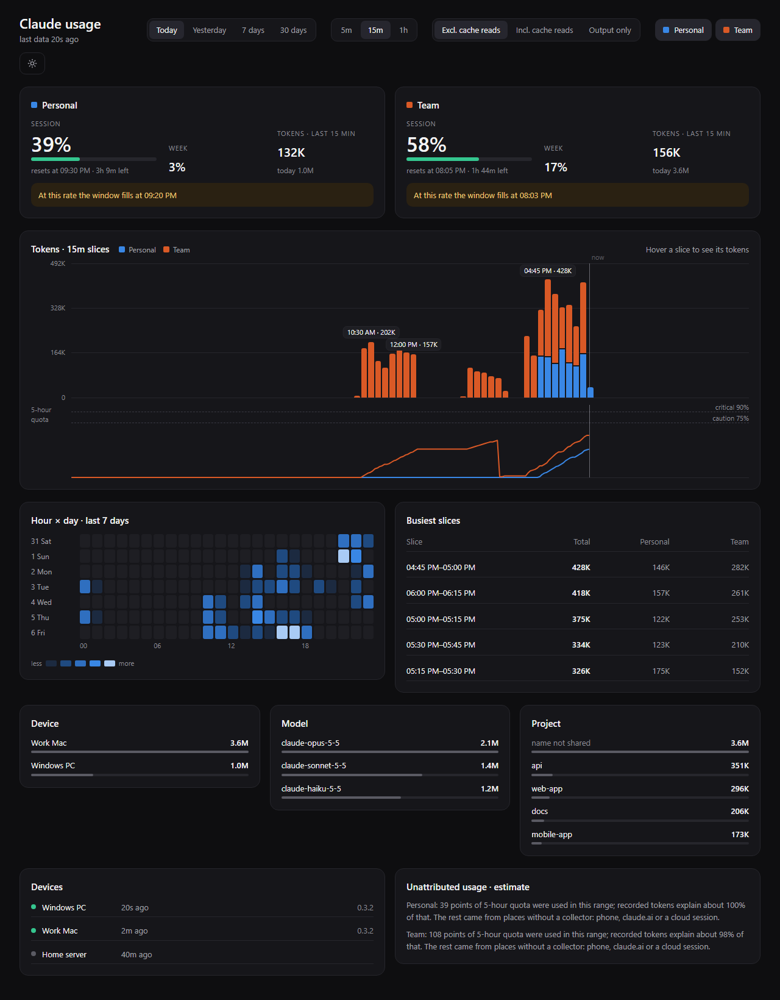
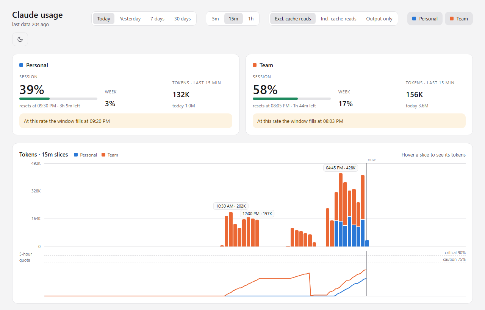

# Claude Usage Widget

A small desktop widget that keeps your Claude Code usage visible across **two
accounts** (personal and team) and **all your devices**: quota windows, when they
reset, how many tokens you are burning — and, the part most tools get wrong,
**how fresh each number actually is**.

<p align="center">
  
</p>

On Windows the percentage also appears in the system tray; on macOS it lives in
the menu bar. The widget can be hidden and brought back from the tray icon. An
optional **hub** merges every device and serves a detailed panel.

---

## Three views

Switch from the buttons in the top right; the choice persists. The window
**fits its content** — it resizes itself when you change views. The chart
button opens the detailed panel.

| Focus | List | Strip |
|:---:|:---:|:---:|
|  |  |  |
| One account large, the other in one line | Every window of both accounts | Smallest footprint |

The big number is **always the session window**. Picking "whichever is highest"
means that when the session resets, the weekly window quietly takes over and the
widget starts telling you about something else. If the account reports no
5-hour window at all (seen on a Max plan since late October 2026), the weekly
window is the main number — and the panel says "Weekly quota" instead.

## Two accounts

Each account is a Claude Code config directory: personal is `~/.claude`, team is
`~/.claude-team` by default (log in there once with
`CLAUDE_CONFIG_DIR=~/.claude-team claude`). Both paths can be changed in
`config.json > accountDirs`. Logging in and out with `/login` would overwrite a
single credentials file and blind the other account; two directories keep both
signed in.

## Tokens

Besides quota, the widget counts **tokens** by reading Claude Code's transcripts
(`<config dir>/projects/**/*.jsonl`, read-only) in a background process. The
same message is written several times while it streams; each one is counted
once (`message.id` + `requestId`). Nothing extra is asked from the API, so
counting costs no tokens.

- **The main number excludes cache reads.** Every request re-reads the whole
  session context from the prompt cache — about 99% of all tokens in a typical
  15 minutes. Counting those makes a quiet quarter hour look like tens of
  millions. The main number is input + output + cache writes; cache reads sit on
  their own line ("+50M read from cache").
- **With a hub, the numbers cover the whole account.** This device's share comes
  from its own collector (no delay), the other devices' from the hub, and a small
  line shows "this device: 76K · today 25M". If the hub is configured but
  unreachable, the widget shows its own number and marks it **"this device
  only"** so a partial number never passes for the total.
- **Check it yourself:** `npm run tokens` recounts the transcripts independently
  of the widget's database (last 15 min, 1 h, 5 h, today, per column).

## It doesn't hide its own state

The point of this widget isn't showing a number. It's **not showing a wrong one.**

| | |
|:---:|:---:|
|  |  |
| Colour shifts near the threshold — but the percentage is always legible, colour never carries information on its own | If the data is old, it **says so**. It never presents a stale value as current |

<p align="center">
  
</p>

Every failure class gets its own wording: signed out · asked too often · response
unreadable. Never a generic "error", because what you should do next depends on
which one it is.

## The panel

<p align="center">
  
</p>

- **Account cards:** quota with reset time, the second window, tokens in the last
  15 minutes and today, and a fill projection ("at this rate the window fills at
  20:03").
- **Tokens over time:** stacked columns per account with the busiest slices
  labelled; 5 minute to 1 day slices over today, yesterday, 7 or 30 days;
  excluding cache reads, including them, or output only.
- **Quota line** on the same time axis but in its **own chart** — two axes on one
  chart would invite false comparisons. Caution and critical thresholds marked.
- **Hour × day heatmap**, busiest slices, device / model / project breakdowns,
  device list with last-seen times.
- **Unattributed usage (estimate):** quota rises that recorded tokens don't
  explain — usage from places without a collector (phone, claude.ai, cloud
  sessions).

Light and dark, desktop and phone widths. The hub serves it on the home network;
inside the widget it opens in its own window and falls back to this device's data
when there is no hub.

<p align="center">
  
</p>

## The hub (optional)

A small Node server (`server/`) that merges token counts and quota samples from
every device and serves the panel.

```bash
docker compose up -d --build   # hub: :3310 home port, :3311 public port
```

It has two listeners:

| Port (container) | Published | Purpose |
|---|---|---|
| `8081` | `3310` | **Home network only.** Panel page, device enrollment, unauthenticated reads |
| `8080` | `3311` | **The one to expose.** Every request needs a device key; no panel, no enrollment |

How you expose `8080` is up to you: a tunnel, a reverse proxy with TLS, or a
port forward. The app only needs an address. **Suggestion:** Tailscale Funnel
works well here: no open ports on the router and a TLS address out of the box.
Cloudflare Tunnel or any reverse proxy is fine too. Never expose `8081`.

The hub can also count the server's own Claude usage: mount that machine's
`~/.claude` read-only at `/claude` and `~/.claude.json` at `/claude.json` in a
compose override.

Each device sends per-minute totals; a minute is always replaced as a whole, and
every minute carries a version, so a late or repeated request can never
overwrite newer data or count anything twice.

### Connecting a device

In the widget's `config.json` (`%APPDATA%\claude-usage-widget\` on Windows,
`~/Library/Application Support/claude-usage-widget/` on macOS):

```json
{
  "hub": {
    "url": "https://your-public-address",
    "lanUrl": "http://192.168.x.y:3310",
    "deviceName": "Work Mac"
  }
}
```

Start the widget **once while on the home network**: it enrolls itself through
`lanUrl` and stores its device key in the same file. After that it sends through
`url` from anywhere, falling back to `lanUrl` at home. The first sync uploads the
device's whole history (about a minute for a year of heavy use).

Project folder names are **not sent** unless `"shareProjectPaths": true`; a work
laptop's project names are work information too.

---

## Why it doesn't parse `/usage` output

This was the most expensive lesson in the project, and it may save you the same
afternoon.

The first version ran `claude -p "/usage"` and parsed the text. It looked like it
worked — until the widget showed **7%** while the real value was **22%**.

`claude --debug-file` gave it away:

```
fetchUtilization: GET /api/oauth/usage (attempt 1)
fetchUtilization: 200 after 1 attempt(s)
[ERROR] Usage fetch returned a fieldless or non-object body (in-band error)
```

Calling the endpoint directly returned **HTTP 429**. The chain was:

1. The widget polled the usage endpoint **once a minute**.
2. The endpoint rate-limited the account.
3. The CLI **swallowed the 429** — it received `200` with an empty body and
   silently printed a **20-minute-old cache** as if it were current.
4. The widget believed it. Nothing looked broken.

> **Two different limits.** What we hit was the *request rate limit* on the usage
> endpoint — how often you may ask for the number — not your *usage quota*.
> Asking for usage costs no tokens.

### How it works now

- Refresh goes **straight to** `GET /api/oauth/usage`, once per account. The
  status code is classified; a 429 is never swallowed, it turns into exponential
  backoff (capped at one hour). `~/.claude.json > cachedUsageUtilization` is the
  structural fallback. No text parsing.
- **The rule that matters:** a record's `at` field is *when the server produced
  the data*, not when we read it. Staleness is derived from that, so showing an
  old value as current isn't a bug you can hit — it's a code path that doesn't
  exist.
- Default interval is **5 minutes per account**, with ±30 s jitter so two devices
  asking about the same account don't hit the endpoint at the same moment.
  `pollIntervalMs` can't go below **2 minutes**, whatever the config says.

> ⚠️ `/api/oauth/usage` is **not a documented endpoint.** If Anthropic changes
> it, this app breaks. It is written to break loudly: when the response isn't
> what it expects, the widget says "unreadable" rather than inventing a number.

---

## Install

Build a Windows installer:

```bash
npm install
npm run dist:win
```

Output lands in `dist/`. The installer is per-user and needs no admin rights.

macOS and Linux targets are configured in `electron-builder.yml`: `LSUIElement`
keeps it out of the macOS dock, and Linux produces an AppImage only.

```bash
npm run dist:mac     # macOS only — electron-builder refuses to cross-build
npm run dist:linux
```

The macOS package is **not signed**. After copying it to `/Applications`, clear
the quarantine flag and sign it locally, otherwise Apple Silicon reports it as
damaged:

```bash
xattr -cr "/Applications/Claude Usage Widget.app"
codesign --force --deep -s - "/Applications/Claude Usage Widget.app"
```

On first launch macOS asks for Keychain access to `Claude Code-credentials`;
choose **Always Allow**.

## Launch it with Claude Code

Add a `SessionStart` hook to `~/.claude/settings.json`:

```json
{
  "hooks": {
    "SessionStart": [
      {
        "matcher": "",
        "hooks": [
          { "type": "command", "command": "node \"<repo>/scripts/launch-widget.mjs\"" }
        ]
      }
    ]
  }
}
```

The launcher follows two rules: it **never blocks** (spawns detached and exits
immediately, so your session start isn't delayed) and it **fails quietly** (exit
code 0 even when the widget isn't installed). Running it twice is harmless — a
single-instance lock means a second launch just brings the existing widget
forward.

---

## Language

The interface is English by default and switches to Turkish when the system
locale is Turkish. There is no language setting — it follows the OS.

Translation coverage is enforced by the type system: `MESSAGES` is typed
`Record<Lang, Record<MessageKey, string>>`, so forgetting a key in one language
is a **compile error** rather than a string that silently falls back.

## Privacy

- The access token is read from `<config dir>/.credentials.json` (Windows,
  Linux) or the macOS Keychain **only to sign the request**. It is never stored,
  logged, or returned.
- Nothing is ever written under `~/.claude/` — that directory is read-only here.
  Transcripts are read for token counts only; message text is never stored.
- No telemetry. Outbound requests go to Anthropic's own usage endpoint and, only
  if you configure one, **your own hub**: per-minute token counts per model,
  quota percentages, and project names only when `shareProjectPaths` is on.
- The device key lives in `config.json`; the panel window never sees it (requests
  go through the main process).
- The local history file stores percentages and timestamps, nothing else.

## Platform status

| Platform | State |
|---|---|
| Windows | **Verified** — developed and used here |
| macOS | **Runs** — built and used on Apple Silicon: Keychain token reading, token counting and hub sync confirmed. The team account's Keychain entry name is inferred, not yet confirmed. Unsigned |
| Linux | Partial — process detection was verified on real Ubuntu. Under Wayland dragging falls back to CSS and saved position can't be applied, so it opens at the primary display's top-right |

Not overstating this table is deliberate.

## Development

```bash
npm run dev          # run the widget in development mode
npm test             # widget, collector, panel and hub tests
npm run typecheck
npm run build        # app + panel (out/panel, also served by the hub)
npm run build:panel  # panel only
npm run tokens       # recount tokens from transcripts, independent of the widget
npm run shots        # regenerate the README screenshots
```

The renderer also runs in a plain browser: in development, when `window.usageApi`
is absent a fake bridge is installed, and `?state=ok|stale|error|critical|loading|no-data`,
`?team=ok|off|…`, `?tokens=ok|device|offline|scan|error|off` plus `?lang=tr|en` let
you walk through every state. A **PREVIEW** badge is shown whenever the fake
bridge is active, so stub data can't be mistaken for real.

The screenshots in this repository are synthetic: the widget views come from
that bridge, the panel from the real hub code running in memory on generated
data. `npm run shots` needs Playwright (`npm i -D playwright`, or point
`PLAYWRIGHT_DIR` at an existing install).

## Known limitations

- Depends on an undocumented endpoint (see above). Which windows it reports
  changes over time; the 5-hour window disappeared for one Max account in late
  October 2026.
- The polling floor (2 minutes) and default (5 minutes) come from getting
  rate-limited at 1 minute, not from a published limit.
- The macOS package is unsigned; Linux has not been run on a real machine since
  0.1.
- The tray icon is invisible on some Linux desktops (GNOME without an
  extension). The app **probes for this**: when the tray can't be confirmed, the
  "hide to tray" option is disabled — otherwise the widget would be
  unrecoverable.

## License

MIT — see [LICENSE](LICENSE).

---

<sub>Source comments are in Turkish; the interface ships in English and Turkish.</sub>
